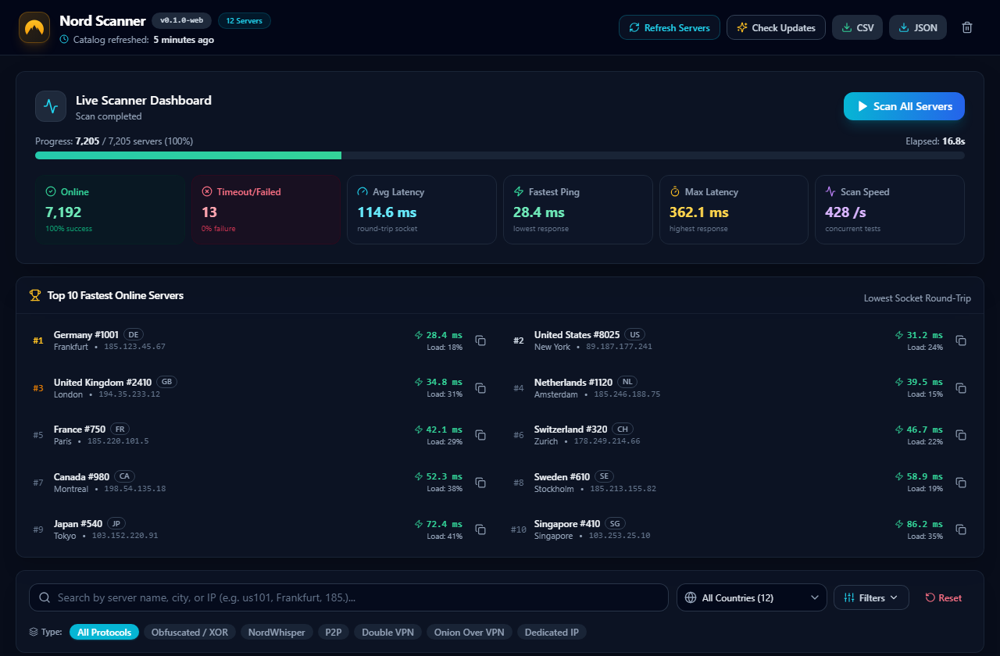
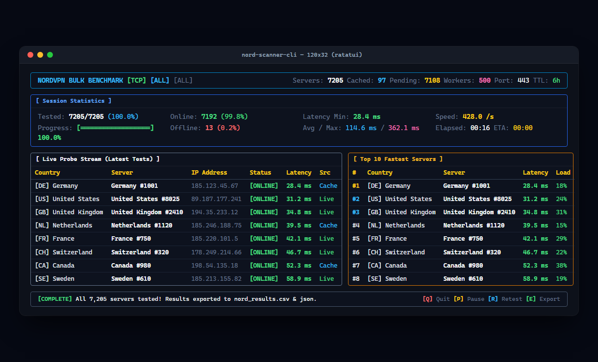

# Nord Scanner

> Fast, concurrent socket benchmark and server latency diagnostic tool for NordVPN. Available as a modern desktop application (Windows, macOS, Linux, Android) and an interactive terminal interface (TUI).

[](https://github.com/arashi-dev/nord-scanner/releases/latest)
[](https://github.com/arashi-dev/nord-scanner/releases/latest)
[](LICENSE)

Nord Scanner performs high-capacity parallel socket handshakes (TCP or TLS) across all 7,200+ NordVPN servers simultaneously in under 20 seconds. It records exact round-trip latencies, identifies active endpoints, ranks the top fastest servers, and caches results in SQLite so restarted scans only test pending nodes.

---

## 🖥️ Previews

### Desktop Application


### Terminal User Interface (TUI)


---

## 📥 Downloads (LTS / Latest Stable)

| Platform | Architecture | Package Format | Download Link |
| :--- | :--- | :--- | :--- |
| **Windows** | x86_64 | Desktop Setup (`.exe`) | [Download .exe](https://github.com/arashi-dev/nord-scanner/releases/latest) |
| | x86_64 | Windows Installer (`.msi`) | [Download .msi](https://github.com/arashi-dev/nord-scanner/releases/latest) |
| | x86_64 | Standalone TUI / CLI (`.zip`) | [Download CLI (.zip)](https://github.com/arashi-dev/nord-scanner/releases/latest/download/nord-scanner-tui-windows-x86_64.zip) |
| **macOS** | Universal (Apple Silicon & Intel) | Disk Image (`.dmg`) | [Download .dmg](https://github.com/arashi-dev/nord-scanner/releases/latest) |
| | Universal | Standalone TUI / CLI (`.tar.gz`) | [Download CLI (.tar.gz)](https://github.com/arashi-dev/nord-scanner/releases/latest/download/nord-scanner-tui-macos-universal.tar.gz) |
| **Linux** | x86_64 / amd64 | AppImage (`.AppImage`) | [Download .AppImage](https://github.com/arashi-dev/nord-scanner/releases/latest) |
| | x86_64 / amd64 | Debian / Ubuntu (`.deb`) | [Download .deb](https://github.com/arashi-dev/nord-scanner/releases/latest) |
| | x86_64 / amd64 | Standalone TUI / CLI (`.tar.gz`) | [Download CLI (.tar.gz)](https://github.com/arashi-dev/nord-scanner/releases/latest/download/nord-scanner-tui-linux-x86_64.tar.gz) |
| **Android** | Universal | Android APK (`.apk`) | [Download APK](https://github.com/arashi-dev/nord-scanner/releases/latest) |

> [!TIP]
> View all release artifacts, SHA256 checksums, and update notes on the [GitHub Releases page](https://github.com/arashi-dev/nord-scanner/releases/latest).

---

## ⚡ Key Features

- **Ultra-Fast Parallel Probing**: Tokio async concurrency benchmarks thousands of endpoints simultaneously (~400+ probes/sec).
- **Persistent SQLite Cache**: Stores verified latencies with configurable TTL (`6h`, `1d`, etc.); restarts skip already-tested servers.
- **Top 10 Live Leaderboard**: Real-time ranking of the fastest online nodes with one-click IP copy.
- **Flexible Filters**: Filter by Country, Port, Protocol (`obfuscated`, `nordwhisper`, `p2p`), Mode (`tcp` / `tls`), and Concurrency.
- **Data Export**: Save benchmark reports to ranked CSV and JSON formats on demand.
- **Built-in Auto-Updater**: Seamless over-the-air updates for desktop releases via Tauri v2.

---

## 🚀 Quick Start (CLI)

Run the standalone CLI binary directly:

```bash
# Scan all servers using default settings (TCP port 443, 500 workers)
nord-scanner-cli

# Benchmark specific countries with custom concurrency
nord-scanner-cli --country US,DE,GB --concurrency 1000

# Probe Obfuscated & NordWhisper servers using cryptographic TLS mode
nord-scanner-cli --type obfuscated,nordwhisper --mode tls

# Retest fresh (bypass cache) and export results upon completion
nord-scanner-cli --force --auto-exit --export-csv results.csv
```

---

## 🛠️ Building from Source

### Prerequisites
- [Node.js](https://nodejs.org/) v20+ and [Rust](https://rustup.rs/) 1.75+

```bash
# Clone repository
git clone https://github.com/arashi-dev/nord-scanner.git
cd nord-scanner

# Install frontend dependencies
npm install

# Run Desktop App in development mode
npm run tauri dev

# Build Desktop App for production
npm run tauri build

# Build CLI / TUI binary
cargo build --release --bin nord-scanner-cli
```
